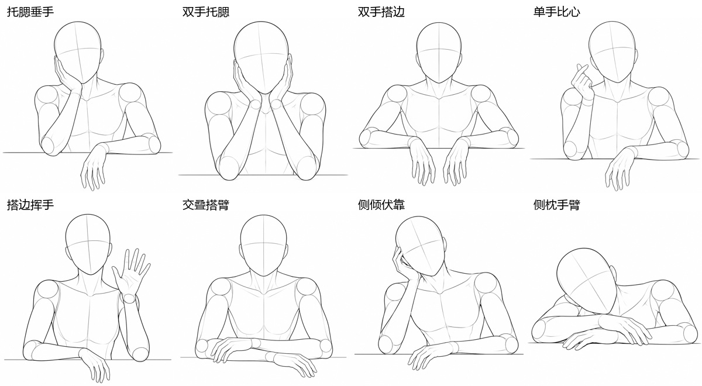

# 趴趴立牌工作台 · Papapai Studio

上传人物照片生成上半身趴趴立牌；将透明 PNG 批量放进场景。全部在本地网页操作，不需要通过命令行制作图片。



## 功能

- 8种统一素体姿势卡：托腮垂手、双手托腮、双手搭边、单手比心、搭边挥手、交叠搭臂、侧倾伏靠、侧枕手臂。
- 通道3 / 通道4分别配置密钥，创建任务时固定通道，不自动切换。
- BiRefNet HR + PyMatting 可选抠图：发丝软蒙版与边缘前景色恢复。
- 简单批量场景生图：选PNG、选场景、批量生成；锁定姿势和手部，支持单张重做。
- AI创意换场景模式、任务历史、逐张验收、成品下载和账号素材分配。

## 本地安装

需要完整安装的 Python 3.10 或以上版本（推荐3.11）。无需 Node.js、Codex、Ego 浏览器或另装生图二进制。

Windows：下载/解压项目到自己的工作目录，双击 `安装.cmd`，首次安装会联网下载 Pillow；完成后双击 `启动工作台.vbs`，自动打开本地网页。

macOS/Linux 或手动安装：

```sh
python3 setup.py
.venv/bin/python launch.py
```

Windows手动启动：

```powershell
.venv\Scripts\python.exe launch.py
```

默认网页地址 http://127.0.0.1:8796 。如果端口被现有工作台占用，在本地 `config.json` 修改端口。服务只监听127.0.0.1，不开放公网。

## 配置生图

安装会从 `config.example.json` 创建本地 `config.json`。复制 `.env.example` 为 `.env` 并在本机填写自己的密钥：

- `CODEX_API_KEY`：通道3。
- `CHANNEL4_API_KEY`：通道4。

两者互不回退。接口地址及模型名在 `config.json` 配置；支持标准 OpenAI-compatible Images API：文生图 JSON、图生图 multipart，返回 `data[0].b64_json` 或 HTTPS `url`。接口若只支持私有SSE协议或自定义参数，需按服务商说明调整 `tools/image_api.py`。每张AI图独立计费；本地透视合成不调用生图接口。

源码部署版使用可读的 Python 接口客户端，未捆绑本机专有CLI。客户端已做本地模拟接口测试，未在打包时发起新的付费云端验证。

**本地配置、密钥、上传素材与任务记录都已列入 `.gitignore`，不要手工强行加入Git。**

## 可选：发丝抠图

```sh
python setup.py --matting
```

从你有权使用的模型来源取得 `BiRefNet_HR-matting.onnx`，放到 `runtime/matting/`，或将 `config.json` 的 `matting_runtime` 指向已有模型目录。参考 [BiRefNet](https://github.com/ZhengPeng7/BiRefNet) 与 [PyMatting](https://github.com/pymatting/pymatting)。本包不含大模型，也不擅自下载不明来源权重。未配置模型时，已有透明PNG仍可做本地场景合成；不透明图的自动抠图需要配置此项。

## 简单批量替换场景

1. 上传或从素材库选择透明立牌PNG。
2. 多选上传场景图片、上传场景文件夹，或输入本机目录读取图片。
3. 在侧栏选择通道3/4，查看预计张数与生图次数，点击“开始批量生图”。
4. 在成品页逐张检查手指、人物姿势、显示器承托与实拍融合。不满意的已完成场景可点“重做这张 · 1次生图”，只生成新的单张结果，原图保留。

默认每个场景生成一张，多张立牌轮流分配；“更多设置”可改为全部组合。无需标角点、涂蒙版或确认干净背景。提示词锁定人物原有角度、趴趴姿势和手指结构，匹配亚克力薄片、光线、接触阴影与原场景。AI可能改动细节，需要逐张验收；这条路线并非逐像素保真。

## 作为技能调用

将 `skills/papapai-studio` 安装到你的技能目录，或让代理读取其中的 `SKILL.md`。第一次使用告知代理本项目实际位置。技能入口包含姿势图制作、工作台部署与场景合成的必要约束，提示词位于该技能的 `references/pose-prompts.json`。

## 上传 GitHub

本目录就是可上传的源码根目录，包含入口文件、网页、测试、八姿图和技能目录。项目仓库：[enzolinc-code/images-papatie-console](https://github.com/enzolinc-code/images-papatie-console)。上传前运行：

```sh
python scripts/release_check.py
python -m unittest discover -v
```

只上传源码，不上传 `.env`、`config.json`、`.venv`、`data`、`qa`、`runtime`。部署包已排除这些文件，以及个人照片、历史任务、二进制程序、ONNX权重。上传同步时只提交上述源码文件。

## 许可与来源

代码为MIT；姿势图和参考资料的来源及使用范围另见 [THIRD_PARTY.md](THIRD_PARTY.md)，不把代码MIT许可误当成第三方图库图片商用许可。

## 从本仓库安装

```sh
git clone https://github.com/enzolinc-code/images-papatie-console.git
cd images-papatie-console
python setup.py
```

作为Codex技能安装（需要Node.js提供npx）：

```sh
npx skills add https://github.com/enzolinc-code/images-papatie-console --skill papapai-studio -g -a codex
```

技能安装只安装代理说明与姿势提示词；完整网页工作台仍按上面的仓库克隆和本地安装步骤部署。


## 简易场景生图（2026-11-13）
场景页面重做为选透明立牌、上传多张场景/读取目录、选择通道、批量生成。不需要角点、蒙版或背景确认。默认AI融合，每张成品一次生图；提示词约束人物角度、趴趴动作和手指结构不变，并匹配亚克力薄片、显示器承托关系与实拍光影。AI并非逐像素保真，完成后逐张验收；已完成场景可单张重做，保留原图、原通道、原参考顺序与提示词，不整批重跑。历史本地合成任务与数据保留，新页面不再暴露标定入口。


## 自动成品目录与分发入口
场景图片完成后自动另存为 `成品/日期/任务ID/序号-场景名.jpg`，不包含原图、raw或中间图。任务上的“打开成品目录”可直接打开；“送到分发工作台”创建独立分发快照，排除标记为需要修正的图，打开8766并携带该目录。此操作不会调用文字模型或自动发布，待检查图应在分发前核对。成品目录不随GitHub源码打包。8766需支持from=papapai&folder=...目录衔接；本机已安装对应页面适配。

其他电脑的8766若未安装衔接入口，可将 integrations/xhs-folder-handoff.js 加载到分发工作台页面（放在原有app.js/batch.js/exclusive.js之后）。适配只读取URL中的目录并提供“读取这批成品”按钮，不调用发布接口。尚未通过目视验收的图片会提示检查；标记需要修正的图片从分发快照中排除。


## 成品库与任务记录
成品页默认按批次展示封面，每页12批；进入批次或全部图片后每页24张，可按作品名、类型、验收、日期和归档状态筛选。任务记录改为每页12条文字列表，详情按需展开，进行中批次单独提示。支持选本页、跨页多选、批量验收及选图分发（排除需修正图），保留透明图片alpha。大图窗口支持左右箭头与通过/需修正后下一张。归档只隐藏记录，不删除文件，可筛选归档后恢复；进行中批次禁止归档。


## 整体工作区（2026-11-13）
主导航整理为制作中心、成品库、任务中心。制作中心可选透明立牌或场景图，分素材、动作/场景、确认生成三步，切步保留控件及选择；确认页展示张数和调用次数。已有素材用弹窗选择，本机路径、目录和少用设置折叠。通道移到右上角，环境状态/保存位置收在设置。作品默认使用类型与时间命名，可改名；编号收在任务详情，完成任务不再显示无效续做按钮。归档/验收/选图分发沿用原逻辑，通道设置和原数据不变。


## 清爽作品文件夹（2026-11-13）
成品库首页只展示单封面、名称、图片数与待检查数。顶部仅搜索、全部/待检查/可分发分类，日期/类型/验收/归档折叠进筛选。进入作品默认只看图片，点击大图连续验收；选择图片后才出现复选框、选择本页和底部分发栏，退出选择清空勾选。改名/归档/目录放在作品内更多，下载/重做放在大图更多；任务进度只在任务中心。可分发分类仅显示已通过图，选图分发仍排除需修正图。为不中断在途生图，library.js实现同时打包到studio.js入口，页面只加载studio.js，不能再额外重复加载library.js。


### 素材星标与标签
透明素材库、场景素材选择支持星标收藏、名称/标签搜索、按标签筛选。卡片角落星形按钮可收藏，悬停或键盘聚焦时显示标签编辑；触屏直接显示。最多8个标签，每个20字。收藏不改变素材原图、名称或选中状态。
记录使用素材ID关联，服务端保存到数据目录的 `material_marks.json`，不进入发布包。浏览器另保存待同步副本；旧服务有生成任务时无需重启即可使用界面，记录先保存在当前浏览器。服务下次启动新版本后，打开该浏览器页面会自动同步。待同步期间请勿清理该站点浏览器存储。
前端 `web/materials.js` 为独立维护源，当前合并到 `studio.js` 尾部，页面不重复加载该源。更新时同步两份。


### 手动微调（高级可选）
手动微调使用原透明PNG本地合成，人物、手指不交给生图模型重绘；允许整张移动、等比例缩放、旋转及已有场景模板的整体透视，包含插值，非逐像素不变。AI自由融合收在“更多设置”，需显式选择。
操作：选择透明立牌 → 添加场景 → “准备场景 / 调整摆放” → 拖动、大小、旋转 → 准备干净背景 → 免费精确预览 → 检查后保存 → 批量保真套图。每个场景准备一次，按文件内容复用。不同造型共用同一区域时仍应检查接触位置；大侧角度优先更换匹配素材。
无旧立牌场景可明确选用原图；有旧立牌可上传同尺寸干净背景，或涂抹旧立牌范围后提交一次AI背景清理。背景清理只接收场景和清理区域参考，不接收新人物PNG；范围外保留原场景。清理完成后重新打开场景检查，预览并确认。
已准备场景每次套图为0次生图；每次AI清理1张背景=1次所选通道生图。未准备场景直接拦截，无自动降级AI自由融合。原文件、任务历史和通道配置不变；图层与合成依据随任务保存在数据目录。
`web/simple-fidelity.js`是独立维护源，当前打包至`studio.js`末尾，不重复加载；无需重启即可复用已有保真接口，保护正在运行的任务。服务下次启动也默认保真。


### 自动保真套场景（高级可选，已取消默认）
选择透明立牌、选择场景、开始自动保真套图即可；不要求手工拖动、涂抹或逐张确认。系统使用本地BiRefNet HR识别旧立牌，检测显示器承托边，自动生成清理范围，首次通过所选通道清理旧背景；随后按原图PNG整体缩放/旋转摆放，匹配轻微环境色、阴影和透明薄边。新人物与手指不上传生图模型、不重画，插值与环境匹色会改变部分像素。
同场景按文件内容hash缓存识别与干净背景，重命名或换人物不会重复付费清理。首次每个新场景最多1次背景生图，已缓存场景0次；计划费用为上限，识别失败不调用生图。识别不可靠、多主体、承托边不明确或画面容纳不下时单独停止，禁止随便放中间。远端背景已提交但结果不明时，同场景后续人物不会再次提交。
识别依赖可通过setup.py --matting安装，需配置BiRefNet_HR-matting.onnx。低清、严重斜角、多主体、无明确承托边的场景可能识别失败；俯拍平放场景选择“桌垫平放”。原PNG需要本身完整、动作正确且抠图干净；输出仍需检查摆放和实物效果，不保证任意场景一次成功。手动微调与AI自由融合仅为显式可选，不自动降级。
自动背景用梯度无缝融合去掉轮廓色差，并强制保留蒙版外原像素。缓存、模型和个人素材不进入GitHub发布包。

亚克力材质修复：保真合成保留独立透明板、方向性切边反光、侧面厚度、柔和阴影和弱反射；人物印刷层不重绘，指缝不填不透明白块。自动清理同时覆盖旧人物印刷与透明外轮廓。缓存已有成图可本地重合成，无需重新生图。


### 当前默认：AI场景融合 + 可选二次手部校正
根据用户回溯要求，默认已恢复AI场景融合，不要求本地保真识别/清理/手工摆放。初次每张1次生图。成品大图“更多 → 二次校正手部”可对照原透明人物修正手臂/手掌/手指，保留当前场景和亚克力效果；每次明确点击校正提交1张/1次生图，不自动执行第二遍。原成品保留，新版本独立待验收，记录来源。连续校正始终使用最初人物PNG和原始场景，不把上一版成品误认作人物标准。沿用原任务通道；本地保真历史成品使用当前所选通道。AI无法保证只改手部，需人工检查新版本。保真方法仅保留为高级可选。

人物锁定与生成前筛选：场景素材步骤可填写经用户确认的人物名称并绑定清晰身份图，透明人物为唯一动作母版；身份/动作/环境职责分开。新任务保存母版关联，多轮校正沿用原始参考。命名明星必须绑定身份图，系统不猜身份。生成前弹窗列出基础质量、可选风险标签及勾选，排除仅影响队列不删除文件；低清/空透明图等硬排除不能勾回，模糊/贴边需检查可放行。脸部、手指遮挡、复杂机位、多主体与强反光需目视判断，非自动语义识别。大图更多支持分别校正人物相似度/手部，每次1张1次，原成品保留。


### 简易样图流程（当前默认）
选母版、选场景，先生成1张；样图大图点击“满意，继续剩余”才提交其余场景，第一张不重复生成。修复后的样图也可以批准继续。继续按钮幂等，固定样图通道、原始母版与提示词快照；不自动把新母版或设置套进旧计划。只拦截无法解码、空透明图、短边不足128等硬错误；软风险不弹强制逐图确认，不删除文件。人物名称与常用要求为可选，按素材ID保存于数据目录，选中自动带入。
修复入口合并为一个，选择人物不像/手指异常/立牌质感不足，分别发对应任务，每次1张1次。当前通道3 CLI与便携HTTP客户端未接入mask参数，服务能力标为unverified，界面明确整图修复，不承诺蒙版外不变。尚未进行收费的蒙版效果对比，不能称为已通过局部编辑实测。

素材删除：两个素材弹窗均支持悬停删除图标、管理模式独立批量勾选、撤销与回收站恢复。仅移出可选素材列表，数据目录material-trash.json持久保存，不物理删除源文件，不破坏历史作品。生成中的任务所用素材禁止删除；批量遇到任一受保护项整批拒绝。管理勾选不修改场景素材勾选。删除配置/原图片不进入部署源码包。

默认生图锁定话术保存在prompts/lock-requirements.txt，保留用户五段原文。新人物姿势制作、场景图与整图修复自动附加，避免重复；背景清理不加人物要求，已提交任务及确认过的样图剩余计划快照不改。参考职责说明避免旧场景人物干扰动作；目标动作生成不会被原站姿锁住。提示词中的输出前检查是模型指令，不等于已实现自动质检。
旧主服务仍有活动任务时，material_bridge.py可在127.0.0.1:8798提供同一回收站的临时兼容读写，CORS仅允许127.0.0.1:8796；前端同步真实删除标记并在弹窗内显示结果，新主接口就绪后自动优先使用主接口。不物理删文件，不允许未知来源写入，不影响生图。


### 全平台统一图片删除
成品卡片悬停删除、大图直接删除、选择图片批量删除、作品更多删除当前作品图片、任务详情删除、参考移除/入回收站、场景移除/入回收站统一使用图片ID。左侧图片回收站统一恢复与永久删除。软删除不销毁源文件，活跃任务保留底层引用，历史费用/任务记录保留；永久删除需二次确认且仍被任务或模板引用时拒绝。系统内置姿势资源不进入个人回收站。
删除同步过滤成品/素材/选择列表、ZIP及新分发，撤销和恢复保留原验收状态。平台导出文件移动至data/trash-exports，防止再次保存任务导出复活，恢复可复位。新分发准备包附image-manifest.json追踪来源，同步移出已删副本；以前没有来源清单的旧包、用户已下载副本、8766已加载草稿或已发布内容不能可靠追溯/撤回，需重新读取或另行处理，不自动删除外部内容。


制作中心独立版块“抠图与高清重构”：无需选择动作，上传后按原动作高清重构，单张单次生图，沿用通道3/4。人物、原动作、可见手指和遮挡为参考锁定要求，不是自动质量保证。折叠项可选仅抠图，保留原像素；原有制作透明立牌的多姿流程和场景制作保留。原图保留，成品另存透明PNG。
